# LL-Verifier

LL-Verifier turns a protocol description, written as a Mermaid sequence diagram, into a Maude model of the protocol
(`rules.maude`) and a model-checking property (`checker.maude`), and model-checks it for access-control flaws.
This artifact contains the tool, the benchmark, every run behind the paper's evaluation, and the scripts that compute
Table 1 from those runs.

## Layout

| Path | Content |
|---|---|
| `src/` | the pipeline; entry point `src/main.py` |
| `lib/` | Maude libraries loaded by generated models (`Iot.maude`, `aux.maude`, `postProcess.maude`, patched prelude) |
| `Maude-3.5.1-macos-arm64/`, `Maude-3.5.1-macos-x86_64/` | bundled Maude 3.5.1 for macOS |
| `benchmark/golden_data/formalModels/<protocol>/` | gold models (`rules.maude`, `checker.maude`) |
| `sequence_diagram/input/<protocol>/diagram.md` | the input diagrams used in the evaluation |
| `sequence_diagram/output/` | the evaluation runs (five runs per protocol each) |
| `evaluation/` | metric scripts, name mappings, manual review verdicts and computed results |
| `scripts/` | batch runner, run aggregation |
| `configs/` | LLM provider and per-stage model configuration |
| `tests/` | unit tests |
| `Vendor-Response/` | vendor replies to our reports (see below) |

Run sets in `sequence_diagram/output/`:

| Directory | Experiment | Config |
|---|---|---|
| `eval-astra-20261105` | main evaluation (Table 1) | `configs/config.yaml` |
| `ablation-norepair-astra-20261105` | ablation without the repair loop | `configs/config-norepair.yaml` |
| `llm-opus55-20261105`, `llm-luna6-20261105` | LLM comparison | `configs/config-opus.yaml`, `configs/config-luna.yaml` |
| `a2a-astra-v2-20261105` | A2A pilot | `configs/config.yaml` |

Each run set has a `manifest.json` with the SHA-256 of the code, libraries, configs and inputs it ran with; the
files in this artifact match those hashes (API keys in `configs/` are replaced by `YOUR_API_KEY`). Each protocol
directory holds the input, the generated `rules.maude` and `checker.maude`, Maude output, the counterexample,
the LLM log (`llm.log`), per-stage records (`stages.json`) and timing and token counts (`run.json`).

## Setup

Requirements: macOS (the bundled Maude binaries are for macOS; on other systems install Maude 3.5.1 and pass
`--maude`), Python 3.12.

```
python3.12 -m venv venv
venv/bin/pip install -r scripts/requirement.txt
venv/bin/python -B -m unittest discover -s tests
```

The pipeline copies the bundled Maude to a temporary directory and runs it with the patched prelude in `lib/`; no
system-wide Maude installation is needed.

## Reproducing Table 1 from the recorded runs (no LLM needed)

```
venv/bin/python -B scripts/eval_table.py sequence_diagram/output/eval-astra-20261105/table \
    sequence_diagram/output/eval-astra-20261105/run{1,2,3,4,5}          # Compile column
venv/bin/python -B evaluation/vocabulary.py                              # Principals, Attributes
venv/bin/python -B evaluation/propositions.py --jobs 8                   # Prop. Proposition (Maude, about 30 s)
venv/bin/python -B evaluation/trace_equiv_manual.py evaluation/results/trace_equiv_manual/export
                                                                         # Flaw Repro. (manual review verdicts)
venv/bin/python -B evaluation/performance.py --jobs 8                    # Time, Tokens, States (Maude, minutes)
venv/bin/python -B evaluation/make_table.py                              # writes evaluation/results/table1.tex
```

`evaluation/README.md` defines every metric. The name mappings between generated and gold models are in
`evaluation/mappings/` (proposed by an LLM, then checked by hand); the manual verdicts on the counterexamples
are in `evaluation/results/trace_equiv_manual/export/`. The other run sets are scored the same way with the run
lists `evaluation/runs-*.txt`.

## Vendor Response

- Philips Hue RTE
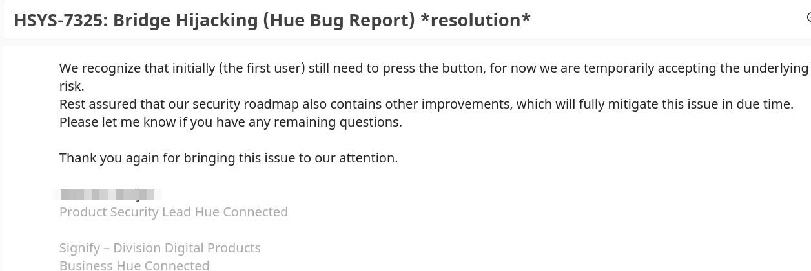
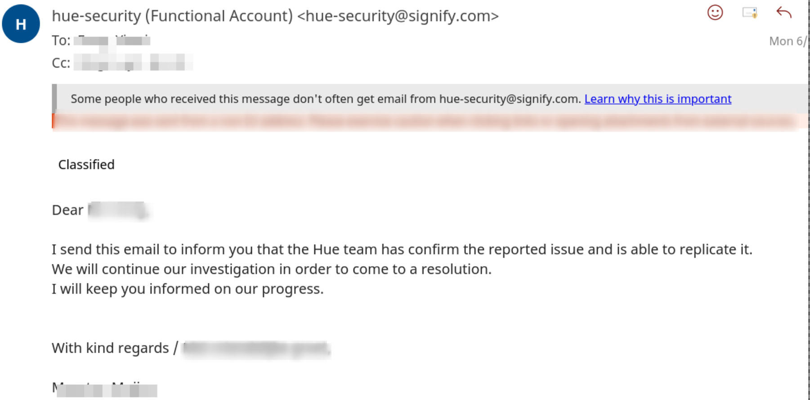
- Broadlink RTE
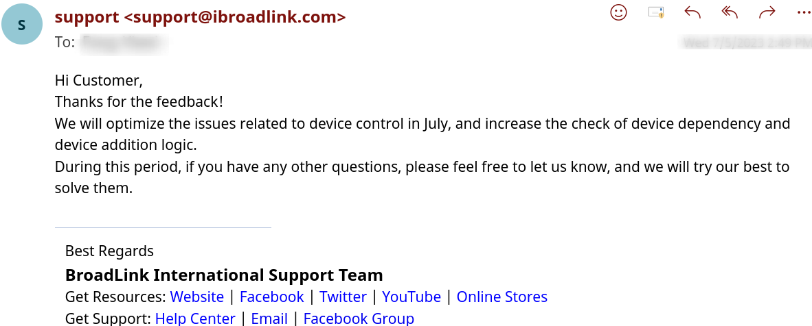
- Imou RTE
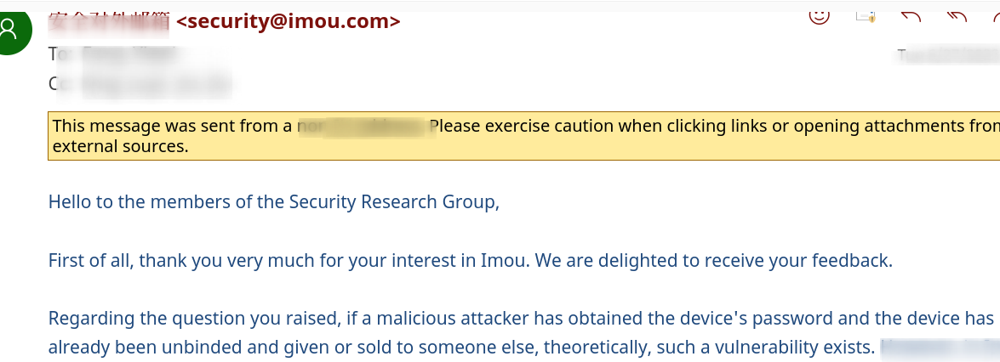
- Aqara (Flaw 8)
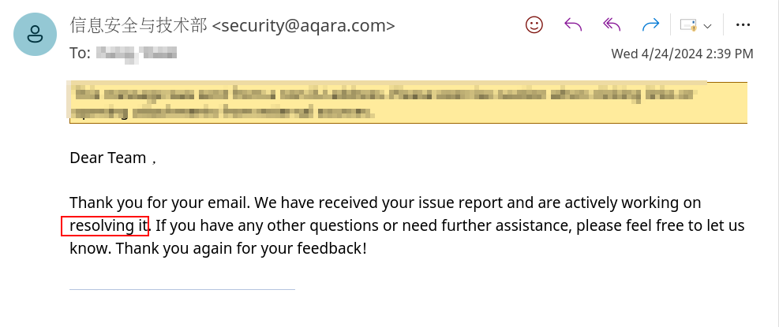
- Tuya (Flaw 9)
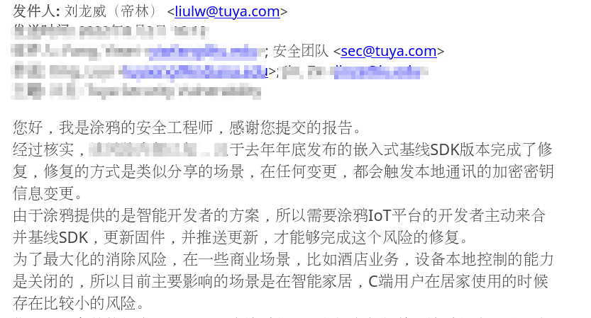
- Beurer RTE
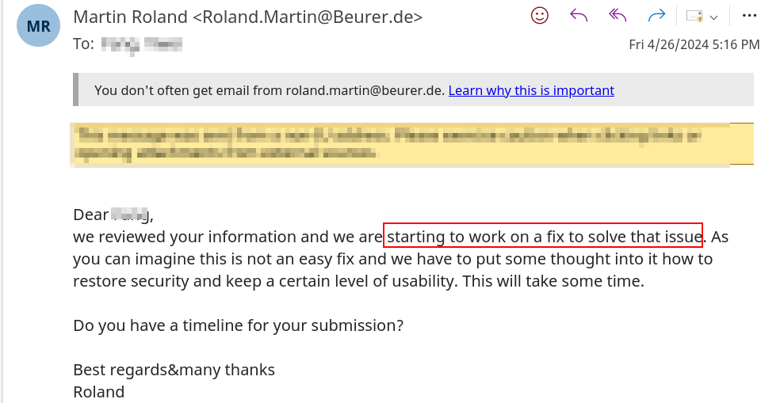
- Govee RTE
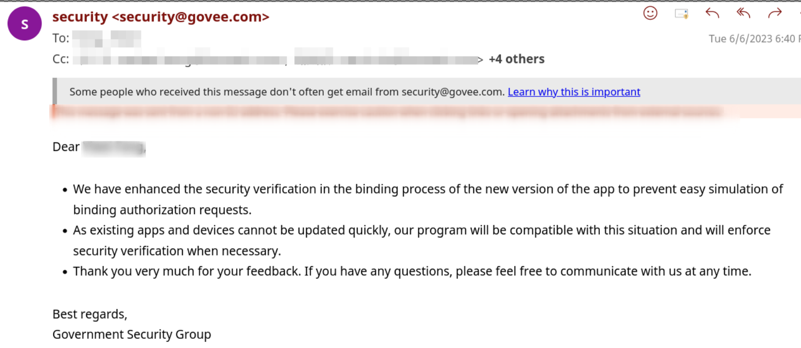
- Meross RTE

- Oray RTE
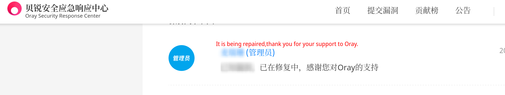
- Switchbot RTE
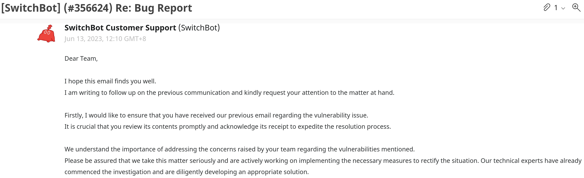
- Wiz RTE
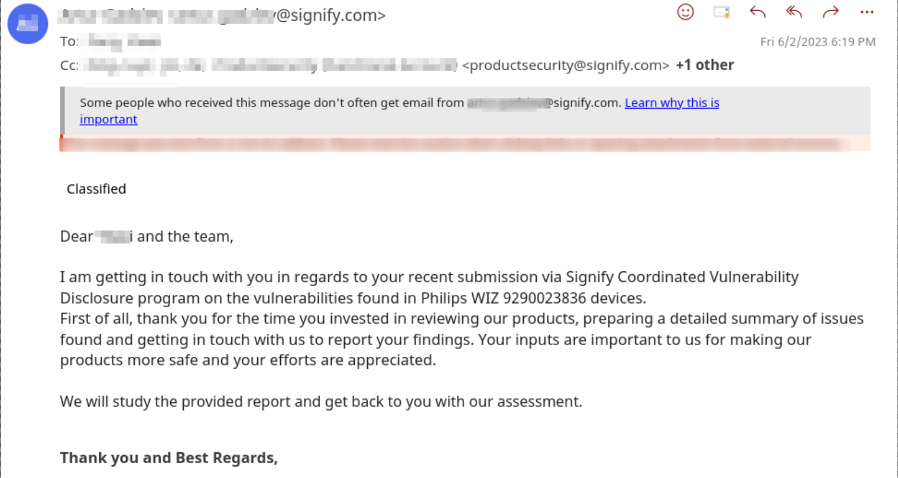
- Xiaomi CAC
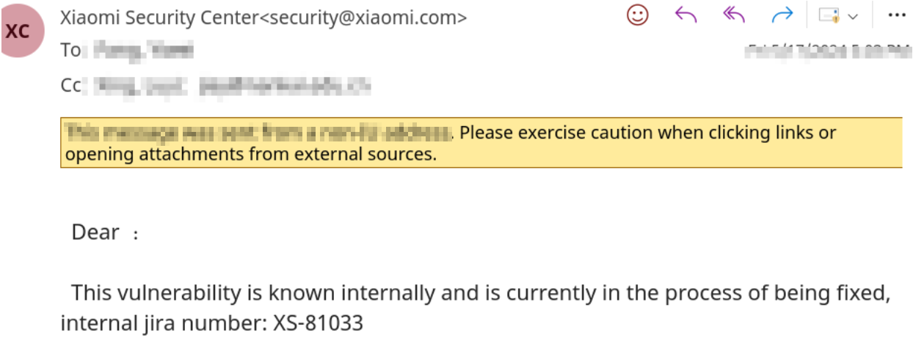

